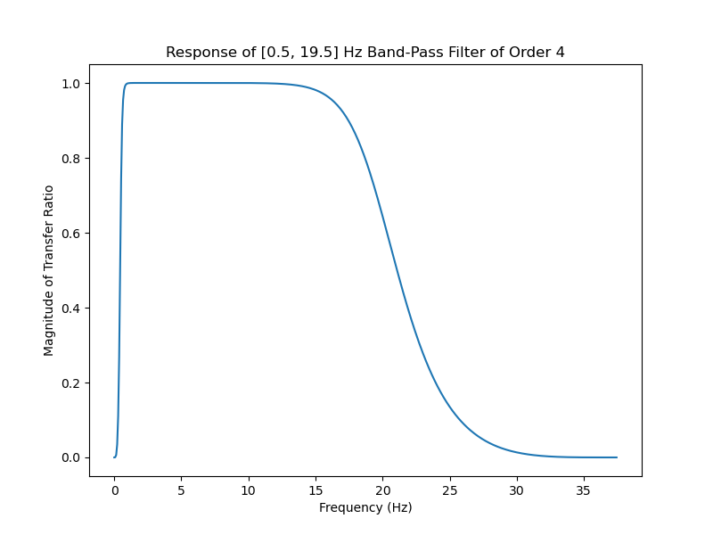
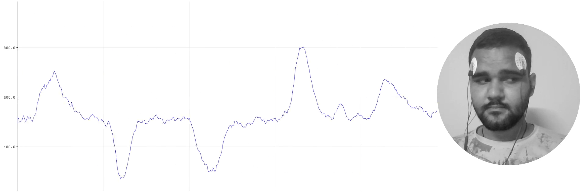

# Eye-BioAmp-Firmware
Firmware for Eye BioAmp hardware from Upside Down Labs

| No. | Program| Description |
| ---- | ------ | ---------- |
|1 | [FixedSampling](01_Fixed_Sampling)| Sample from ADC at a fixed rate for easy processing of signal.|
|2 | [EOGFilter](02_EOG_Filter)| A 0.5 - 19.5 Hz band-pass filter for clean Electrooculography.|
|3 | [DrowsinessDetection](03_Drowsiness_Detection)| Drowsiness detection using eye blink detection.|
|4 | [EOGPhotoCaptureBLE](04_EOG_Photo_Capture_BLE)| EOG based photo clicking machine using ESP32 BLE.|
|5 | [EyeBlinkDetection](05_Eye_Blink_Detection)| EOG based eye blink detection.|
|6 | [EOGDinoGame](06_EOG_Dino_Game)| Controlling chrome dino game using eye blinks.|
|7 | [EOGServoControl](07_EOG_Servo_Control)| Controlling 3D printed servo claw using eye blinks.|
|8 | [VerticalEyeMovementDetector](08_Vertical_Eye_Movement_Detector)| Detect vertical eye movements using EOG signals.|
|9 | [EOGServoR4](09_EOG_Servo_R4)| Servo claw control using EOG blinks for Arduino UNO R4.|
|10 | [EOGDinoR4](10_EOG_Dino_R4)| Chrome Dino game control using EOG blinks for Arduino UNO R4.|
|11 | [EOGSlidesControl](11_EOG_Slides_Control)| Presentation slide control using double/triple EOG blinks.|
|12 | [BlinkMorse](12_Blink_Morse)| Morse code communication using EOG eye blink detection.|

Compatibility of various boards with Brain-BioAmp sensors
<table>
    <thead>
        <tr>
            <th>No.</th>
            <th>Development Board</th>
             <th>Maximum ADC Resolution</th>
            <th>Sensor</th>
            <th>Compatibility</th>
        </tr>
    </thead>
    <tbody>
        <tr>
            <td >1</td>
            <td align= "center" >Arduino UNO R3 & Maker UNO</td>
            <td align = "center" >10 bits</td>
            <td>Bioamp EXG Pill</td>
            <td align = "center">✅</td>
        </tr>
        <tr>
            <td >2</td>
            <td align = "center" >Arduino UNO R4 Minima & Arduino UNO R4 Wifi</td>
            <td align = "center">14 bits</td>
            <td>Bioamp EXG Pill</td>
            <td align= "center">✅</td>
        </tr>
        <tr>
            <td >3</td>
            <td align = "center" >Raspberry Pi Pico</td>
            <td align = "center" >12 bits</td>
            <td>Bioamp EXG Pill</td>
            <td align = "center">❌</td>
        </tr>
       <tr>
             <td >4</td>
            <td align= "center"  >ESP32 C3 MINI</td>
           <td align = "center" >12 bits</td>
            <td align = "center">Bioamp EXG Pill</td>
            <td align= "center">❌</td>
        </tr>
        <tr>
             <td >5</td>
            <td align= "center"  >Arduino Due</td>
           <td align = "center" >12 bits</td>
            <td>Bioamp EXG Pill</td>
            <td align = "center">✅</td>
        </tr>
        <tr>
             <td>6</td>
            <td align= "center"  >Arduino Nano</td>
           <td align = "center" >10 bits</td>
            <td>Bioamp EXG Pill</td>
            <td align = "center">✅</td>
        </tr>
        </tbody>
    </table>

## Examples

1. **EOG Filter**

    A band-pass filter for EOG signals between 0.5 Hz and 19.5 Hz

    
    

2. **Eye Blink Detection**

    Eye Blink Detection using EOG signals.

    
